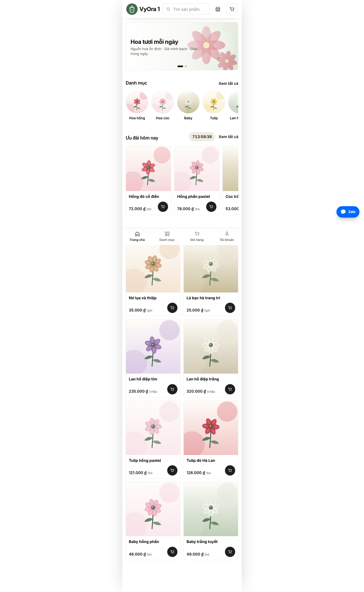
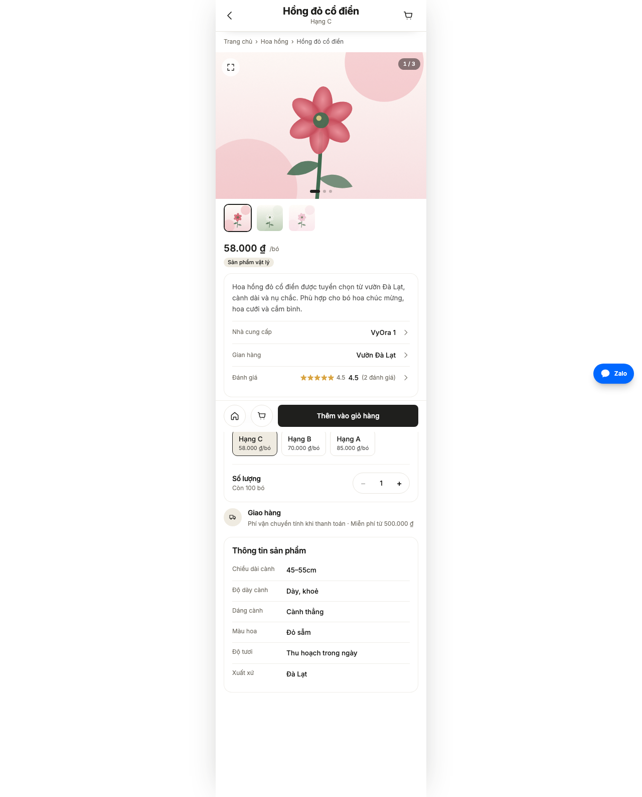
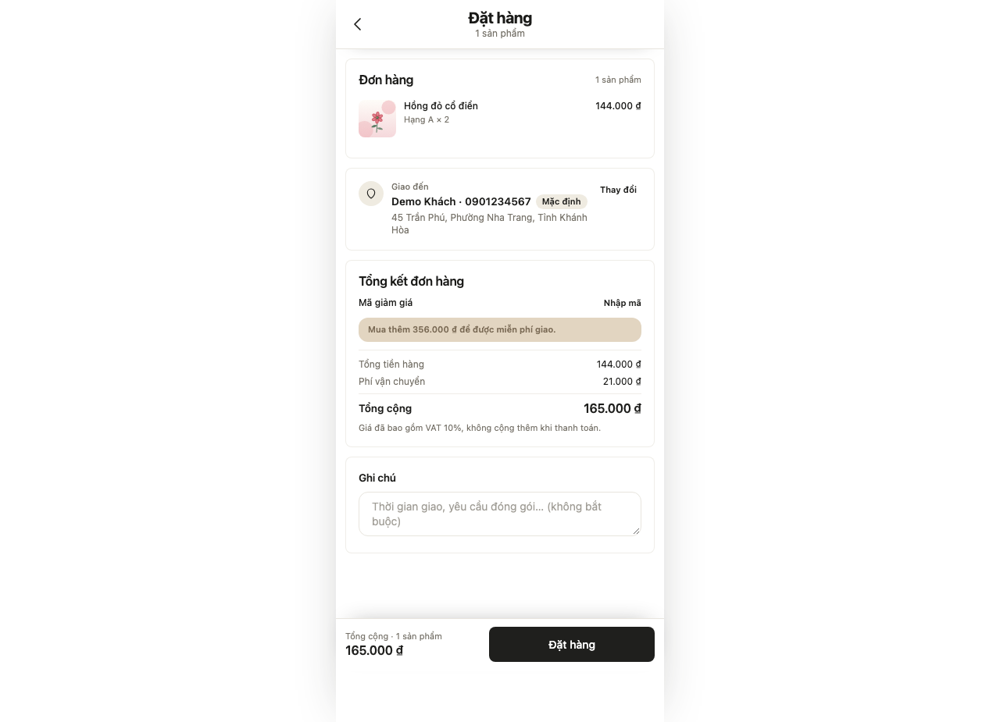
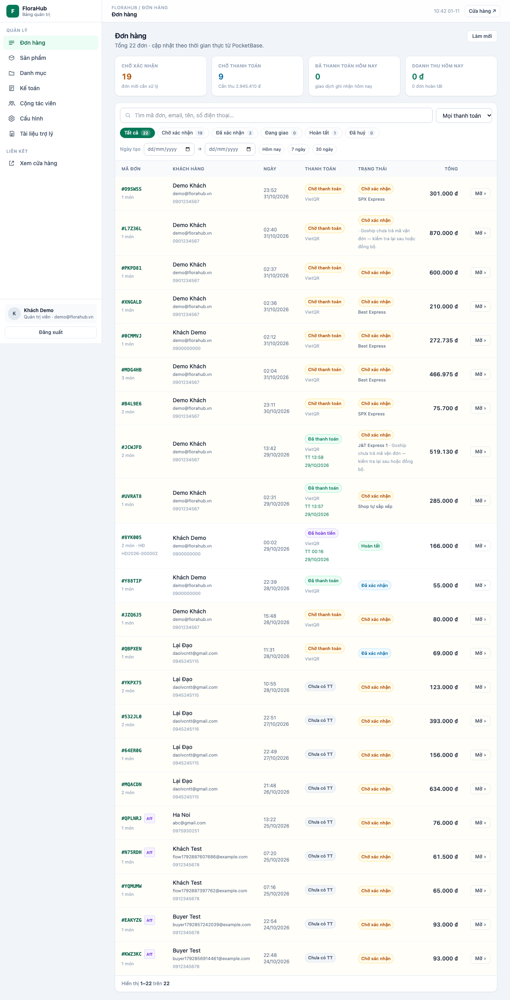
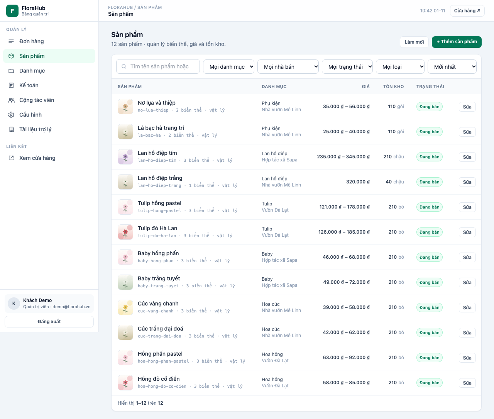
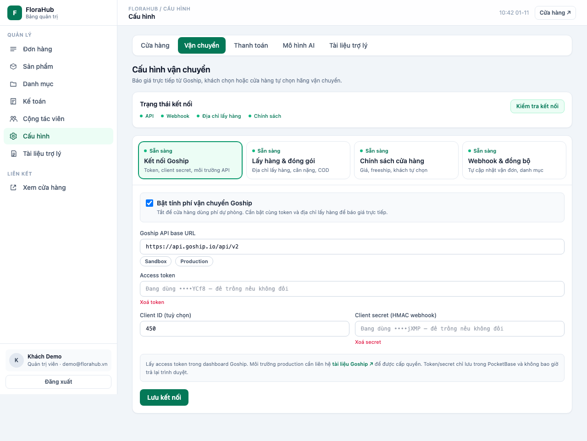

# FloraHub

Nền tảng thương mại điện tử **mã nguồn mở** (Nuxt 3 + PocketBase) cho shop Việt Nam — gom **thanh toán** và **vận chuyển** vào một chỗ, chạy trên hạ tầng của chính bạn.

> **Một nền tảng, hơn 10 hãng vận chuyển.** Kết nối qua Goship một lần, dùng được GHN, GHTK, Viettel Post, VNPost, J&T, Best, Ninja Van, Grab, Be, Ahamove… — **không phải ký hợp đồng và tích hợp riêng với từng hãng.**
>
> **Thanh toán tự xác thực.** Khách chuyển khoản/QR xong, hệ thống tự đối chiếu và chuyển đơn sang "đã thanh toán" trong vài giây — **không cập nhật thủ công.**
>
> **Xuyên suốt, không phụ thuộc.** Từ lúc khách chọn hãng ở checkout đến lúc tạo vận đơn, theo dõi, thu COD và hoàn tất đơn — một luồng liền mạch, dữ liệu nằm trong tay bạn.

---

## Ảnh chứng minh

**Cửa hàng**

| Trang chủ | Chi tiết sản phẩm | Đặt hàng |
|---|---|---|
|  |  |  |

**Quản trị**

| Đơn hàng | Sản phẩm | Vận chuyển (Goship) |
|---|---|---|
|  |  |  |

> Ảnh chụp từ dữ liệu demo (tên shop "VyOra 1"). Xem thêm trong [`docs/huong-dan-su-dung.md`](docs/huong-dan-su-dung.md).

---

## Vì sao chọn FloraHub

| Vấn đề thường gặp | FloraHub giải quyết |
|---|---|
| Phải làm việc với 10 hãng vận chuyển, 10 hợp đồng, 10 API | Kết nối **Goship 1 lần** → báo giá và tạo vận đơn cho hơn 10 hãng ngay trong admin |
| Khách chuyển khoản rồi, phải ngồi đối chiếu sao kê | **Webhook + đối soát tự động**, đơn tự chuyển "đã thanh toán", cập nhật realtime |
| Sàn khóa dữ liệu, phí thay đổi, phụ thuộc bên thứ ba | **Mã nguồn mở**, tự host, dữ liệu và cấu hình phí trong tay bạn |
| Phí ship tự đặt, lỗ cước | Cước **realtime** theo tuyến + cân nặng, có **markup** và **freeship** tùy chỉnh |
| Quản lý nhiều hãng rối | Admin chọn hãng đã tối ưu, hệ thống tự chọn sẵn **hãng khách đã chọn** khi tạo vận đơn |

## Tính năng

### Vận chuyển — một cửa cho hơn 10 hãng
- Báo giá cước realtime theo địa chỉ lấy–giao, cân nặng quy đổi.
- Khách chọn hãng/dịch vụ ở checkout, hoặc shop để hệ thống tự chọn (rẻ nhất / nhanh nhất / hãng ưu tiên).
- Tạo vận đơn, in mã theo dõi, đồng bộ trạng thái, huỷ vận đơn ngay trong đơn hàng.
- Chính sách phí linh hoạt: **markup %**, **ngưỡng freeship**, chặn/giới hạn hãng.
- Dự phòng phí phẳng khi hãng lỗi — checkout không sập.

### Thanh toán — tự động, không thủ công
- **VietQR động** mang sẵn số tiền và nội dung `ORD-XXXXXX` (miễn phí phí cổng).
- **Webhook xác nhận** khi tiền về; **đối soát dự phòng** qua SePay Open API.
- Trang đơn cập nhật **realtime** (SSE) khi trạng thái đổi — webhook, đối soát hay admin xác nhận.
- **Cổng hosted SePay** (thẻ/QR/NAPAS) khi cần, ký HMAC-SHA256, IPN chống trùng.
- Chống trùng theo mã giao dịch; hỗ trợ COD.

### Bán hàng & vận hành
- Sản phẩm, biến thể, danh mục, tìm kiếm, giỏ hàng, flash sale, bài viết.
- Tài khoản khách: địa chỉ, ví, thông báo, theo dõi đơn.
- **Tiếp thị liên kết:** link giới thiệu, hoa hồng, đối soát và chi trả.
- **Quản trị:** dashboard, đơn hàng, sản phẩm, hoá đơn VAT, sổ kế toán.
- **Trợ lý AI:** tạo nội dung sản phẩm, chat hỏi đáp theo tài liệu shop.
- **Studio:** chỉnh giao diện trực quan.

## Công nghệ

Nuxt 3 (Vue 3, Nitro, TypeScript, Tailwind CSS) · PocketBase (SQLite + realtime + auth) · Caddy (HTTPS tự động) · systemd.

## Bắt đầu nhanh

### Cài lên VPS (1 click)

```bash
curl -fsSL https://raw.githubusercontent.com/algodaohub/florahub/main/deploy/install.sh -o install.sh
sudo bash install.sh
```

Tự động cài Node.js, PocketBase, tạo dữ liệu mẫu, build website, bật HTTPS. Chi tiết: [`docs/trien-khai-vps.md`](docs/trien-khai-vps.md).

### Chạy tại máy (phát triển)

```bash
git clone https://github.com/algodaohub/florahub.git
cd florahub
cp .env.example .env
npm install
npm run pb:setup   # tạo schema + dữ liệu mẫu
npm run dev        # http://127.0.0.1:4321
```

Đăng nhập `/admin/login` bằng `demo@florahub.vn / FloraHub1234`.

## Tài liệu

- [Hướng dẫn sử dụng](docs/huong-dan-su-dung.md)
- [Triển khai lên VPS](docs/trien-khai-vps.md)
- [Kế hoạch quản trị](docs/admin-plan.md)
- [Tích hợp vận chuyển Goship](docs/ke-hoach-tich-hop-goship.md)
- [Luồng thanh toán SePay](docs/luong-thanh-toan-sepay.md)
- [Kế hoạch dữ liệu PocketBase](docs/pocketbase-data-plan.md)
- [Cấu hình cửa hàng](docs/store-config-plan.md)

## Đăng ký dịch vụ tích hợp

| Dịch vụ | Dùng cho | Đăng ký |
|---|---|---|
| **Goship** | Vận chuyển hơn 10 hãng, vận đơn | https://shop.goship.io/login?ref=daolv |
| **SePay** | Xác nhận chuyển khoản tự động | https://my.sepay.vn/register?gcid=361 |
| OpenAI | Trợ lý AI | https://platform.openai.com |
| Anthropic | Trợ lý AI | https://console.anthropic.com |
| Cloudflare | DNS + chống DDoS (miễn phí) | https://dash.cloudflare.com |

> Hai link Goship và SePay ở trên là **link giới thiệu** — đăng ký qua đó, không tốn thêm chi phí.

## Liên hệ & hỗ trợ

[](https://zalo.me/0945245115)

- **Zalo / Hotline:** [0945245115](https://zalo.me/0945245115)
- **Góp ý / báo lỗi:** mở issue trên GitHub.

## Biến môi trường

Xem [`.env.example`](.env.example). Bí mật thanh toán nhập trong `/admin/payments`, không đặt trong `.env`.

## Giấy phép

Phát hành theo [MIT License](LICENSE) — tự do dùng, sửa, thương mại, kèm giữ thông báo bản quyền.
