# Hướng dẫn sử dụng FloraHub

FloraHub gồm 2 phần:

- **Cửa hàng** (`/`) — khách xem sản phẩm, thêm giỏ, đặt hàng, theo dõi đơn, xem ví/hoa hồng.
- **Quản trị** (`/admin`) — chủ shop quản lý sản phẩm, đơn, vận chuyển, thanh toán, cấu hình.

Đăng nhập quản trị: `/admin/login`.

---

## A. Dành cho khách hàng

| Trang | Đường dẫn | Việc |
|---|---|---|
| Trang chủ | `/` | Banner, sản phẩm nổi bật, danh mục |
| Danh mục | `/categories` | Duyệt theo danh mục |
| Sản phẩm | `/product/<đường-dẫn>` | Chi tiết, chọn biến thể, thêm giỏ |
| Tìm kiếm | `/search` | Tìm theo tên |
| Flash sale | `/flash-sale` | Sản phẩm khuyến mãi |
| Giỏ hàng | `/cart` | Xem/sửa giỏ |
| Thanh toán | `/checkout` | Nhập địa chỉ, chọn vận chuyển, thanh toán |
| Theo dõi đơn | `/track-order` | Tra đơn bằng mã |
| Đơn của tôi | `/account/orders` | Lịch sử đơn |
| Ví | `/account/wallet` | Số dư |
| Tiếp thị | `/account/affiliate` | Link giới thiệu, hoa hồng, rút tiền |
| Trợ lý | `/tro-ly` | Chat hỏi đáp |

**Đặt hàng:** chọn sản phẩm → `/cart` → `/checkout` → nhập người nhận + chọn tỉnh/phường → hệ thống báo **phí giao hàng** (khách trả) → chọn **chuyển khoản (VietQR)** hoặc **COD** → đặt.

**Thanh toán VietQR:** quét mã chứa sẵn số tiền và nội dung `ORD-XXXXXX`. Hệ thống tự xác nhận khi tiền về (webhook SePay), trang đơn cập nhật realtime.

### Ảnh minh hoạ

| Trang chủ | Danh mục | Sản phẩm |
|---|---|---|
| 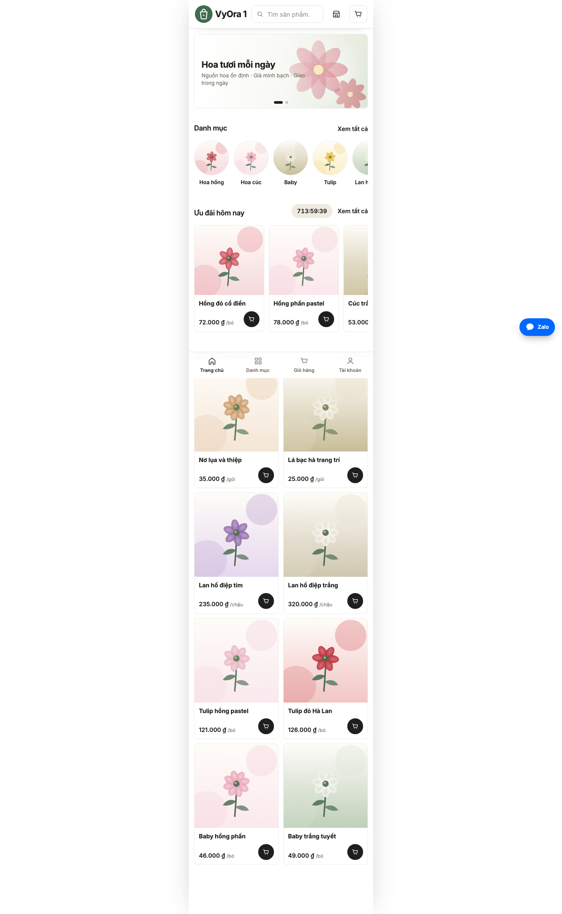 | 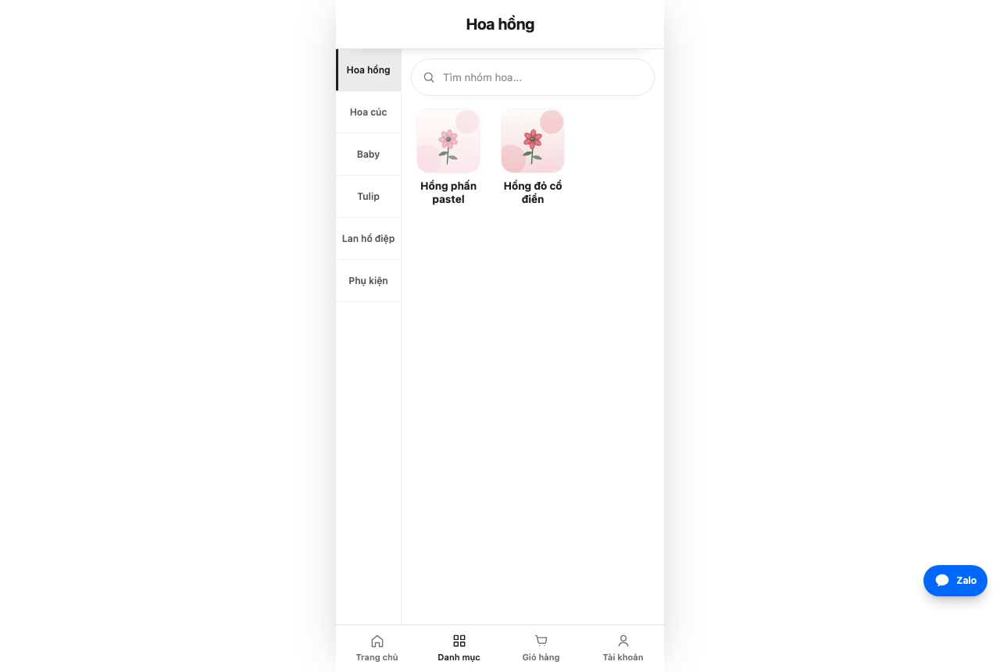 | 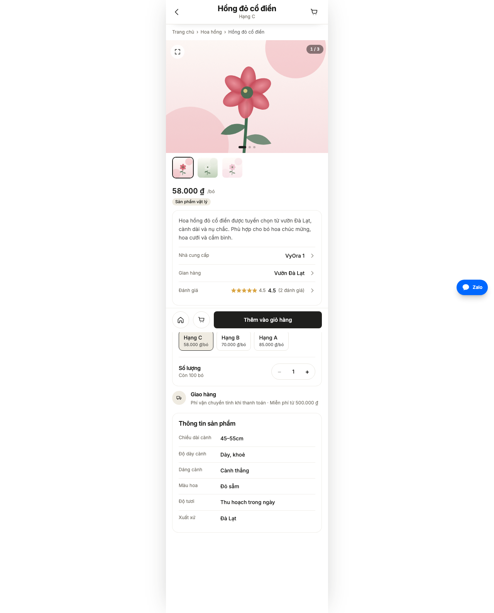 |

| Giỏ hàng | Đặt hàng | Tra đơn |
|---|---|---|
| 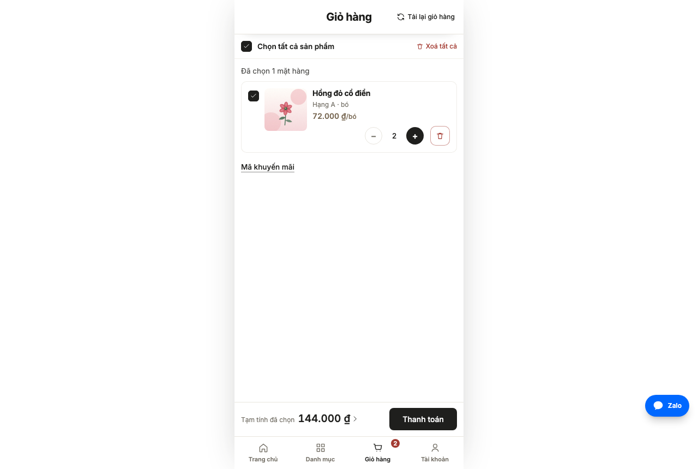 | 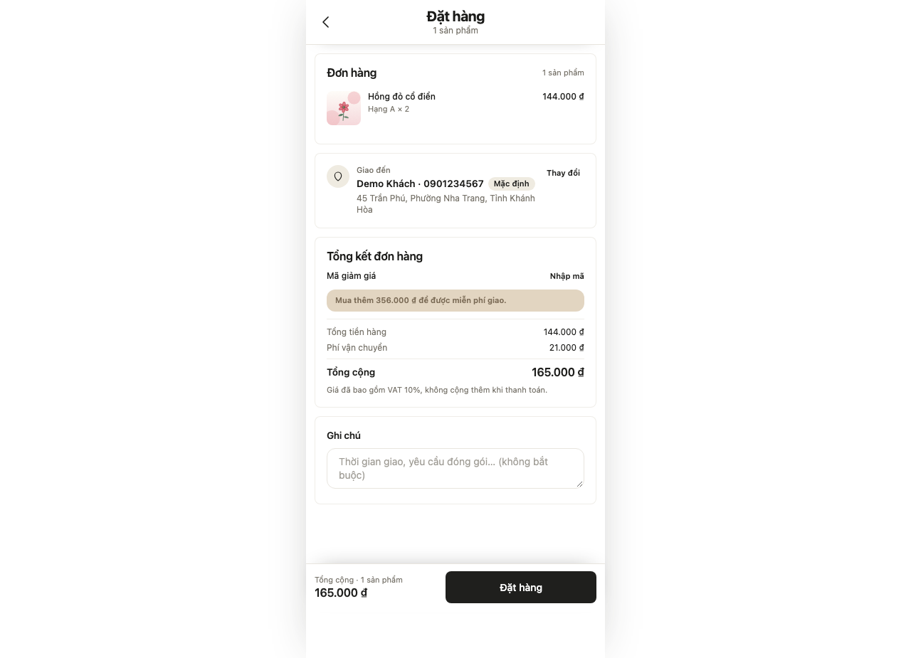 | 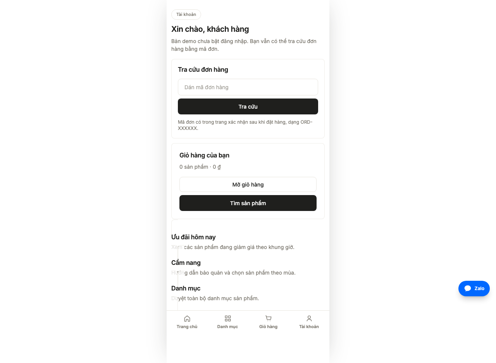 |

| Flash sale | Trợ lý AI | Đăng nhập |
|---|---|---|
| 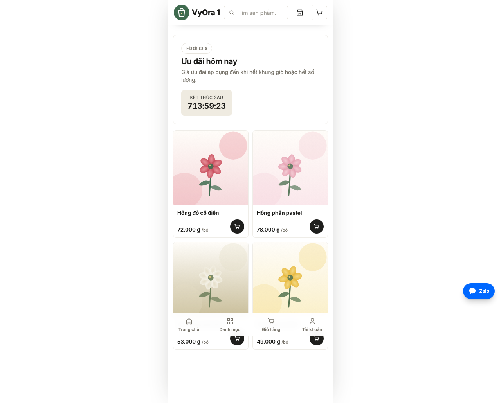 | 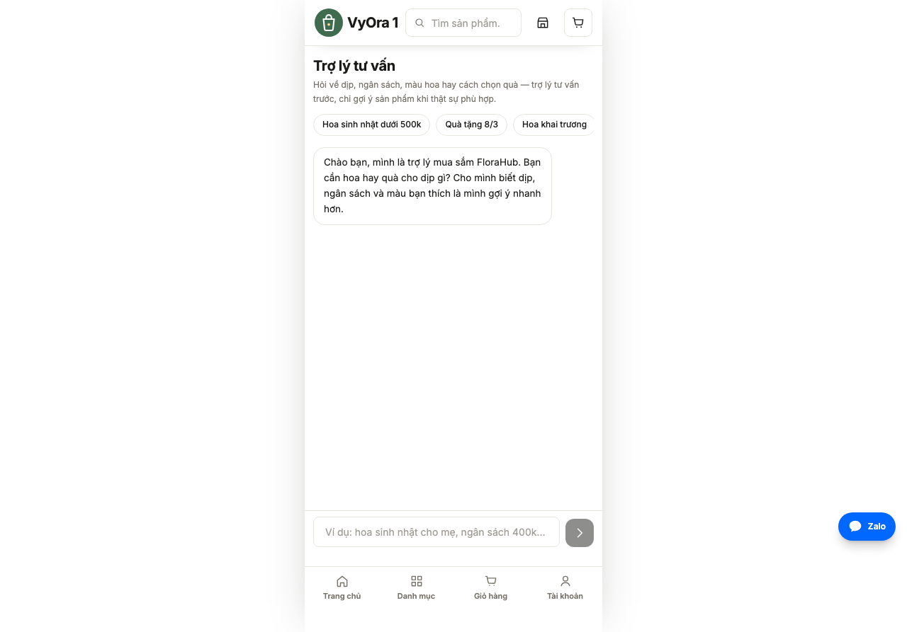 | 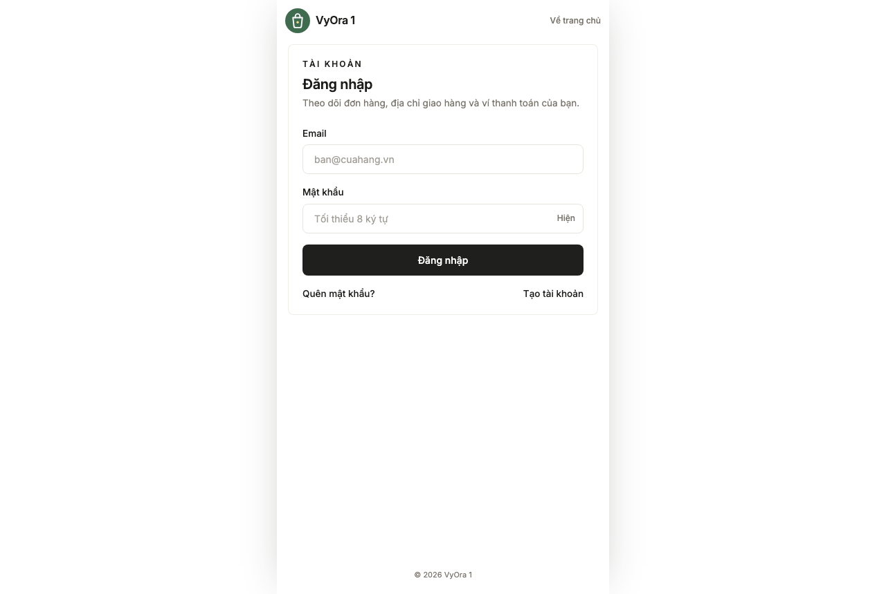 |

---

## B. Dành cho chủ shop (`/admin`)

### 1. Tổng quan — `/admin`
Doanh thu, đơn mới, sản phẩm bán chạy, việc cần xử lý.

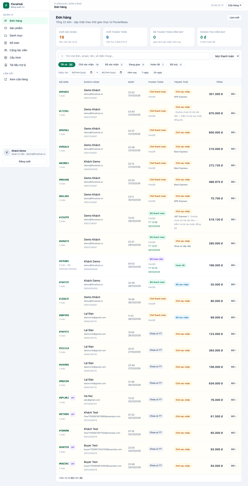

### 2. Sản phẩm — `/admin/products`
- **Thêm:** `/admin/products/new` — tiêu đề, ảnh, giá, tồn kho, biến thể, danh mục, mô tả.
- **Sửa:** mở sản phẩm → các tab (thông tin, biến thể, hình ảnh, SEO). Có nút **tạo nội dung bằng AI**.
- **Danh mục:** `/admin/categories`.

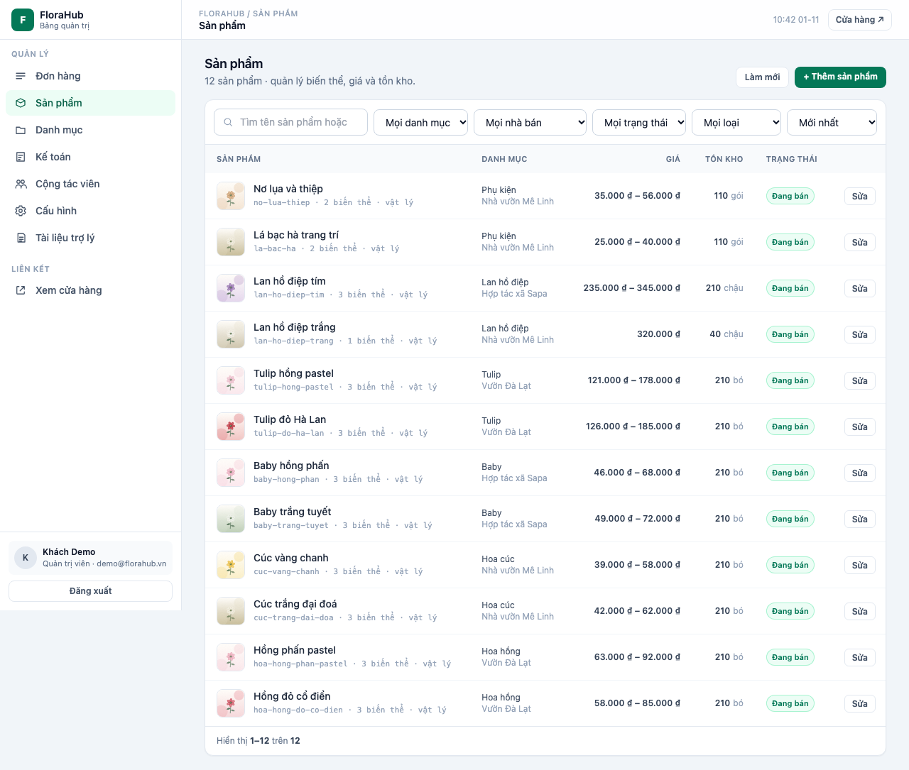

### 3. Đơn hàng — `/admin/orders`
- Danh sách: lọc theo trạng thái (`pending` → `confirmed` → `shipping` → `completed` / `cancelled`).
- Chi tiết đơn `/admin/orders/<id>`:
  - **Người nhận & ghi chú** — sửa địa chỉ (đổi tỉnh/phường sẽ báo giá lại).
  - **Giao hàng & vận chuyển** — báo giá, chọn hãng, **Tạo vận đơn**, **Đồng bộ**, **Huỷ vận đơn**.
  - **Thanh toán** — phí giao hàng khách trả, phí hãng shop trả, xác nhận đã thanh toán, QR.
  - **Hoá đơn & bút toán** — xuất hoá đơn VAT, xem bút toán kế toán.

**Luồng vận chuyển:** đơn chưa có vận đơn → hệ thống **tự chọn sẵn hãng khách đã chọn** → bấm *Tạo vận đơn*. Khi đã tạo, chỉ hiển thị hãng đã chọn (muốn đổi phải *Huỷ vận đơn* trước).

**Chọn hãng vận chuyển ngay trong đơn** — không cần rời trang hay cuộn hết trang: mục *Đơn vị vận chuyển* hiện danh sách hãng kèm giá, nhãn gợi ý (**Nhanh nhất**, **Rẻ nhất**, **Đề xuất**) và tỷ lệ giao thành công.

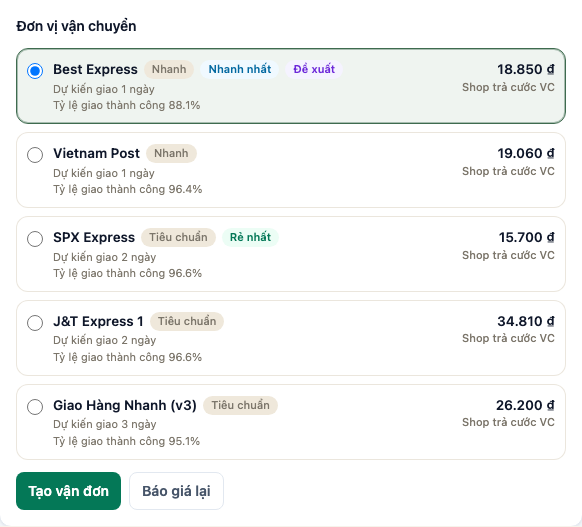

### 4. Vận chuyển — `/admin/shipping`
Bật Goship, nhập API token / client id / secret, địa chỉ lấy hàng, cân nặng kiện. Chính sách phí:
- **Markup %** — cộng thêm vào cước hãng (lãi vận chuyển). Ví dụ cước hãng 15.700₫, markup 10% → khách trả 18.000₫.
- **Ngưỡng freeship** — đơn từ mức này miễn phí giao.
- **Cho khách chọn hãng** — hiện danh sách để khách chọn.

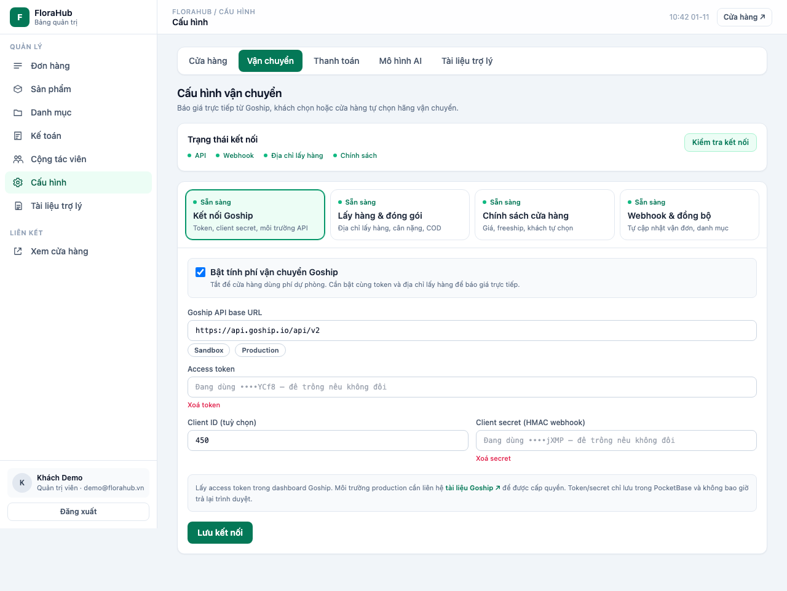

### 5. Thanh toán — `/admin/payments`
Bật **VietQR** (miễn phí phí cổng) hoặc **cổng SePay** (hosted, có phí). Nhập token, webhook secret, thông tin ngân hàng. Webhook: `/api/webhooks/sepay`.

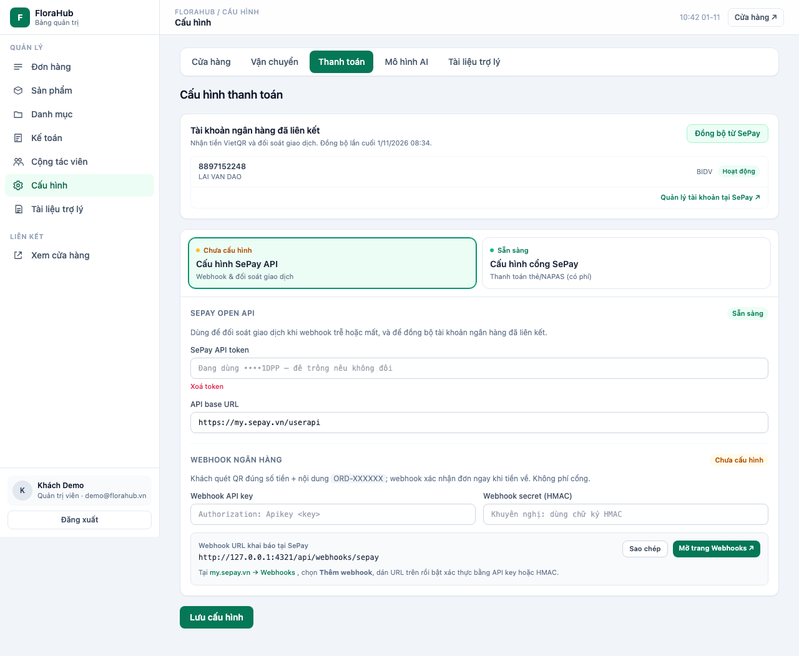

### 6. Cấu hình — `/admin/settings`
- **Cửa hàng** — tên, logo, màu, banner, thông tin liên hệ.
- **Vận chuyển / Thanh toán** — trùng mục 4 và 5.
- **Mô hình AI** — chọn nhà cung cấp (OpenAI / Anthropic / 9router / tuỳ chỉnh).
- **Tài liệu trợ lý** — dạy trợ lý AI trả lời đúng nội dung shop.

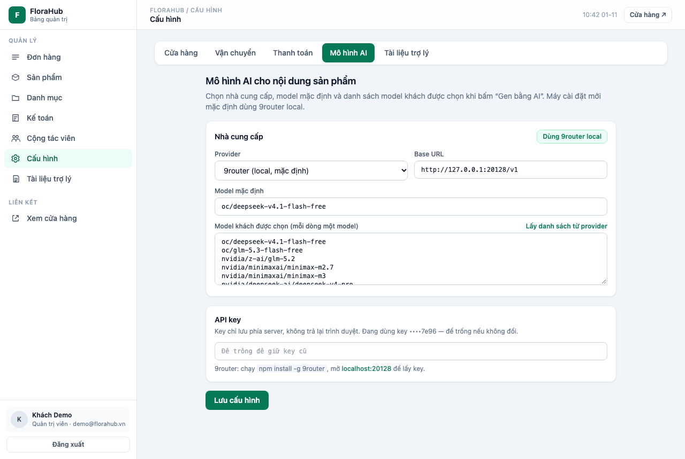

### 7. Tiếp thị liên kết — `/admin/affiliates`
Duyệt affiliate, xem hoa hồng. Chi trả tại `/admin/affiliate-payouts`.

### 8. Kế toán — `/admin/accounting`
Sổ bút toán, đối soát doanh thu và chi phí vận chuyển.

### 9. Studio — `/studio`
Chỉnh giao diện cửa hàng trực quan (cần khoá `NUXT_STUDIO_KEY`).

---

## C. Xem thêm

- Chi tiết kiến trúc & tính năng nâng cao: `docs/admin-plan.md`
- Luồng vận chuyển Goship: `docs/ke-hoach-tich-hop-goship.md`
- Luồng thanh toán SePay: `docs/luong-thanh-toan-sepay.md`
- Cài đặt lên VPS: `docs/trien-khai-vps.md`
